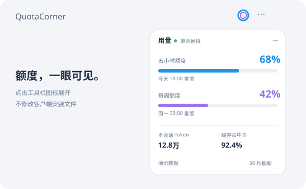

# QuotaCorner

Windows ChatGPT / Codex 客户端顶部工具栏的额度进度条。图标位于“三个点”左边，点击展开或收起；蓝色显示五小时剩余，紫色显示每周剩余，附本会话 Token 与缓存命中率。

Collapsible quota progress bars for the Windows ChatGPT / Codex desktop client. Local-only runtime injection; no app.asar patching. This is an unofficial community tool.



图中为演示数据。实际值来自当前登录的 Codex 订阅。额度每 30 秒刷新，本机会话统计单独刷新；收起状态随客户端保存。

组件使用客户端自身的背景、文字、字体、边框、阴影和图表强调色。切换浅色、深色或自定义主题时即时同步；默认蓝紫双色会随主题的图表色调整。只有客户端未提供主题信息时才回退到系统主题。

这是 Codex 订阅额度，不是 ChatGPT 普通聊天各模型的消息次数。未知额度显示横线，查询失败保留上次值并标记过期，不把未知值当 0%。

## 安装与启动

需要 Windows 10/11、已经登录的 ChatGPT / Codex 桌面客户端、Node.js 22+；推荐 PowerShell 7。无需 `npm install` 即可运行，npm 依赖仅用于开发测试。

从 [本仓库](https://github.com/zianyx6/QuotaCorner) 的 Code → Download ZIP 下载并解压，或执行：

```powershell
git clone https://github.com/zianyx6/QuotaCorner.git
cd QuotaCorner
pwsh -NoProfile -File .\install.ps1
```

安装到当前用户 `%LOCALAPPDATA%\Programs\QuotaCorner`，创建 **QuotaCorner** 桌面快捷方式。正常退出客户端，再双击此快捷方式打开。若自动发现失败，传入真实 `-DesktopPath` 和 `-CliPath`；不要复制别人电脑上的路径。

未安装 PowerShell 7 时，可使用 `powershell -NoProfile -ExecutionPolicy Bypass -File .\install.ps1`。启动器使用当前系统自带 PowerShell 隐藏启动。

当前客户端有本机 CDP 时，运行安装目录中的 launch.ps1 即可连接；否则正常退出客户端，再通过 QuotaCorner 快捷方式打开。不要从客户端原图标启动后期待自动挂载。

## 数据与边界

- 通过官方 Codex CLI app-server 读取账户额度，读取本地会话日志计算 Token 和缓存率。无需填写 API Key。
- 不修改客户端安装文件、模型配置或登录文件；无自动续跑、第三方预测请求或自动更新。
- 调试接口仅限本机回环地址。组件保留本机 CDP 的访问能力，应只运行可信源码。
- 只在自己的目录保存启动配置和运行记录；会话统计从日志重建，收起状态保存在客户端 quota-corner-ui-v1 存储键中。
- 非官方组件，客户端更新后可能需要适配。启动时会重新发现当前客户端，并自动补回缺失或过期的 Store CLI 副本；自定义 CLI 路径失效时重新运行安装脚本。
- 普通 ChatGPT 聊天无法提供 Codex 会话 Token 时显示横线，账户额度仍可显示。

## 卸载

运行已安装目录中的 `pwsh -NoProfile -File .\uninstall.ps1`。移除组件后台、监视界面、专用目录与快捷方式，保留客户端。调试端口在客户端正常退出后关闭。

MIT 授权采集代码来源见 NOTICE.md 和 vendor/LICENSE。前端与后台入口均为可编辑源码，无 npm 运行依赖。

## 开发与验证

```powershell
npm ci --ignore-scripts
npm run check
npm test
pwsh -NoProfile -File .\scripts\build-release.ps1
```

测试覆盖周期区分、未知值与零值、百分比边界、收起状态恢复、工具栏定位、失联提示、清理和 CDP 回环地址限制。GitHub Actions 在 Windows 上检查 Node.js 22 与 24；真实客户端兼容性仍需实际验证。

运行包由白名单生成到 `dist/`，不包含本机配置、账号数据、测试依赖或捆绑的 Codex 可执行文件。

## 兼容性与排查

- 当前已实测客户端版本：Windows `26.1021.3705.0`。不能保证所有历史或未来版本的页面结构均兼容。
- 图标默认插入顶部工具栏的“聊天操作 / Chat actions / Conversation actions”按钮左边。未找到匹配按钮时回退到右上角。
- 面板提示“监视器已停止”：从专用快捷方式重连；若客户端没有 CDP，先正常退出再通过该快捷方式打开。
- 查询失败保留上次结果并标记过期；官方 API 的统计日期可能滞后，本地会话 Token 不代表跨设备账户总量。
- 启动器失败时会在弹窗中显示具体原因，同时写入 `%LOCALAPPDATA%\QuotaCorner\launcher-error.log`；后台日志为同目录的 `runtime.log` 与 `error.log`。反馈时请只提供脱敏错误，不附会话原始日志或登录文件。

## License

MIT。采集模块保留原项目许可证与来源声明；其余代码使用本仓库根目录的 LICENSE。
